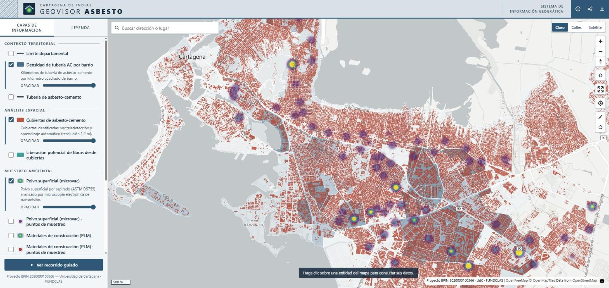
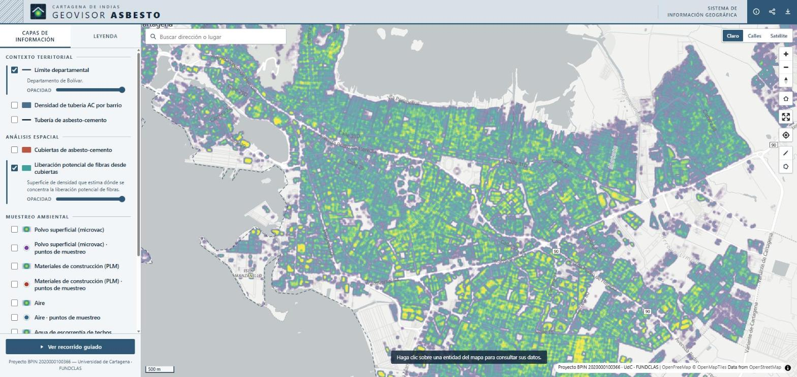
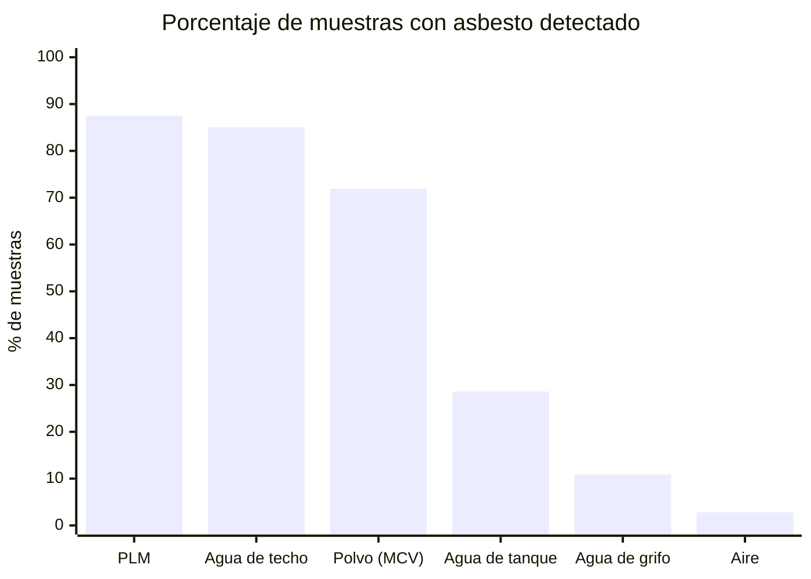
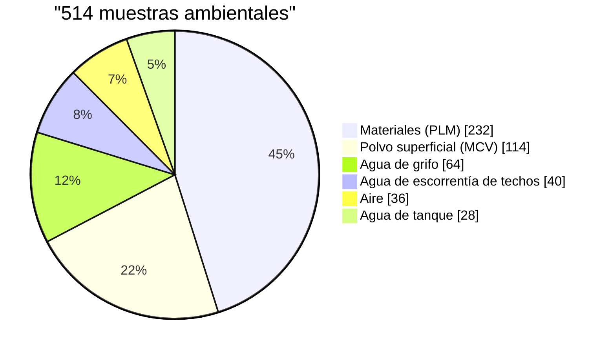
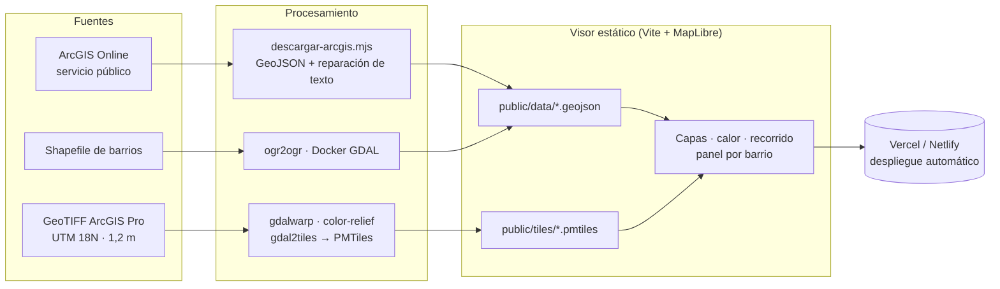

<div align="center">


# Geovisor Asbesto · Cartagena de Indias

**Visor web público y de código abierto sobre la presencia de asbesto en el entorno urbano de Cartagena**
Proyecto **BPIN 2020000100366** · Universidad de Cartagena · FUNDCLAS

[](https://geovisor-asbesto.vercel.app)

[](https://hits.sh/github.com/Aikenort26/geovisor-asbesto/)
[](https://github.com/Aikenort26/geovisor-asbesto/stargazers)
[](https://github.com/Aikenort26/geovisor-asbesto/releases)
[](https://github.com/Aikenort26/geovisor-asbesto/releases/latest)
[](https://geovisor-asbesto.vercel.app)
[](https://github.com/Aikenort26/geovisor-asbesto/commits/main)

[](https://maplibre.org/)
[](https://www.typescriptlang.org/)
[](https://vitejs.dev/)
[](https://protomaps.com/docs/pmtiles)
[](tests/)
[](LICENSE)
[](LICENSE)

</div>

---

<table>
<tr>
<td width="50%"></td>
<td width="50%"></td>
</tr>
<tr>
<td align="center"><sub><b>Cubiertas de asbesto-cemento</b> (1,2 m), densidad de tubería AC por barrio y polvo superficial</sub></td>
<td align="center"><sub><b>Liberación potencial de fibras</b> desde cubiertas</sub></td>
</tr>
</table>

## En cifras

| 514 | 189 | 255 km | 11,8 km² | ≈1 millón |
|:---:|:---:|:---:|:---:|:---:|
| muestras ambientales analizadas | barrios caracterizados | de tubería de asbesto-cemento | de cubiertas de asbesto-cemento | habitantes en los barrios estudiados |

### Muestras con asbesto detectado, por tipo



| Tipo de muestra | Analizadas | Con asbesto | % |
|---|---:|---:|---:|
| Materiales de construcción (PLM) | 232 | 203 | 87,5 |
| Agua de escorrentía de techos | 40 | 34 | 85,0 |
| Polvo superficial (microvac, TEM) | 114 | 82 | 71,9 |
| Agua de tanque | 28 | 8 | 28,6 |
| Agua de grifo | 64 | 7 | 10,9 |
| Aire (TEM) | 36 | 1 | 2,8 |

### Composición del muestreo



> Las cifras se calculan a partir de los datos publicados en `public/data/`. Una muestra cuenta como positiva cuando el análisis identificó algún tipo de asbesto (crisotilo, crocidolita, amosita, antofilita).

## Funciones

- **Capas:** cubiertas de asbesto-cemento (teledetección y aprendizaje automático, 1,2 m), liberación potencial de fibras, polvo superficial, materiales, aire, tres tipos de agua y la red de acueducto en asbesto-cemento con su densidad por barrio.
- **Privacidad:** las muestras se ven como mapas de calor, que se ocultan sobre el zoom 16 para no señalar viviendas. Los puntos originales están disponibles, pero apagados.
- **Recorrido guiado** de 6 paradas, **panel de indicadores por barrio**, buscador de barrios y direcciones, medición de distancias y áreas.
- **Compartir** la vista con sus capas y **exportar** un PNG con cabecera, leyenda y atribución.
- Mapas base claro, calles y satélite, todos sin clave de API. Interfaz adaptada a celular y respetuosa de `prefers-reduced-motion`.

## Cómo funciona



## Desarrollo

```bash
npm install
npm run dev        # http://localhost:5173
npm test           # pruebas unitarias (Vitest)
npm run build      # verificación de tipos y build de producción
```

### Regenerar los datos

1. **Capas vectoriales** desde el servicio público de ArcGIS: `npm run datos`. Verifica el número de entidades de cada capa (`scripts/capas-fuente.json`) y repara los textos con caracteres rotos.
2. **Barrios** desde el shapefile: `FUENTES=/ruta/INFO_GEOVISOR/CAPAS sh scripts/shp-a-geojson.sh`.
3. **Ráster** (cubiertas y mapa de calor): `FUENTES=/ruta/INFO_GEOVISOR/CAPAS sh scripts/raster-a-pmtiles.sh` y luego `uv run --with pmtiles python scripts/mbtiles-a-pmtiles.py`. Las rampas de color están en `scripts/paletas/`.

Los GeoTIFF originales (1,5 GB) no se versionan.

## Despliegue

- **Vercel:** cada push a `main` publica una nueva versión.
- **Netlify:** el repositorio trae `netlify.toml` (compilación) y `public/_headers` (lectura por rangos de las teselas). Basta con vincular el repositorio desde Netlify.
- **Paquete listo para subir:** en [Releases](https://github.com/Aikenort26/geovisor-asbesto/releases) está el sitio compilado en un `.zip`, para arrastrar a Netlify Drop o a cualquier hosting estático.

## Historial de estrellas

<a href="https://star-history.com/#Aikenort26/geovisor-asbesto&Date">
  
</a>

## Licencia y cita

- **Código:** MIT.
- **Datos:** CC BY 4.0.

**Cita sugerida:** Universidad de Cartagena y FUNDCLAS (2026). *Geovisor Asbesto Cartagena* [aplicación web]. Proyecto BPIN 2020000100366. https://geovisor-asbesto.vercel.app
